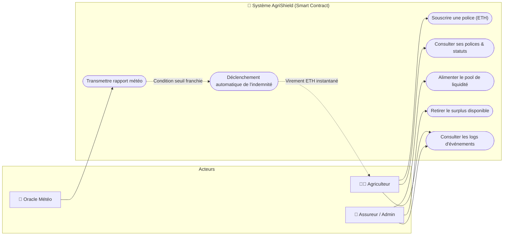
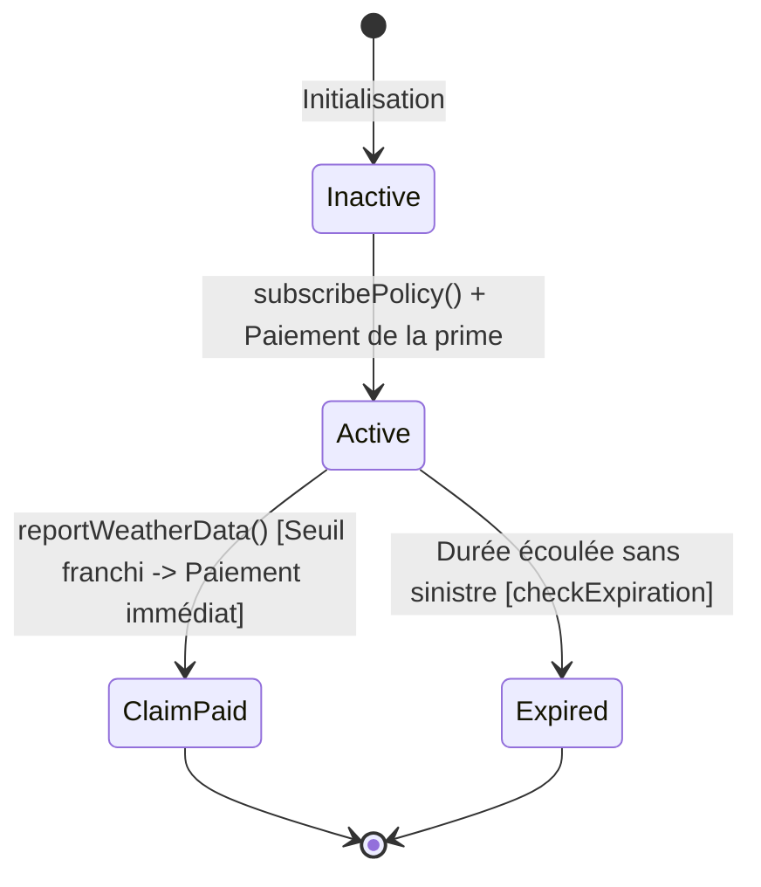

# 🌾 AgriShield : Micro-Assurance Paramétrique Agricole Décentralisée sur Ethereum

> **Module :** Blockchain (IGL4 - Semestre 1)  
> **Enseignante :** Mme Nourhene Ellouze  
> **Étudiants :**  
> * **Iskander Boughnimi :** Conception théorique, Smart Contract Solidity (`AgriShield.sol`), Tests de sécurité & Modificateurs RBAC.  
> * **Ghazi Mouaddeb :** Architecture On/Off-chain, Interface DApp Web3 (`app.js`), Intégration Ethers.js & Scénarios de démonstration.  
> *(Projet mené en étroite collaboration sur l'ensemble des phases)*  
> **Année universitaire :** 2026 – 2027  
> **Technologies :** Solidity (^0.8.20), Ethereum / EVM, Ethers.js, HTML5 / Tailwind CSS, Remix IDE / Ganache.

---

## 1. Contexte & Problématique

Dans le secteur agricole méditerranéen (particulièrement en Tunisie), les agriculteurs subissent de plein fouet les aléas climatiques (sécheresses récurrentes, canicules extrêmes, gelées tardives).

### 1.1 Limites du modèle centralisé traditionnel (Web2)
* **Lenteur des indemnisations :** L'agriculteur doit attendre le passage d'experts sur le terrain et la validation par des commissions. Les délais de remboursement dépassent souvent **6 à 12 mois**, provoquant la faillite des petites exploitations.
* **Conflit d'intérêts :** La compagnie d'assurance privée a un intérêt économique direct à contester les sinistres ou à minimiser les indemnités.
* **Frais de gestion élevés :** Les coûts administratifs de traitement des dossiers excluent les petits exploitants (impossibilité de proposer de la *micro-assurance* rentable).
* **Opacité :** Absence de registre transparent et vérifiable sur les critères d'indemnisation.

### 1.2 La Solution : AgriShield
**AgriShield** remplace l'expert d'assurance par un **Smart Contract autonome** et une alimentation de données météo par **Oracle**. 
Dès qu'une station météo ou un relevé satellite certifié rapporte une valeur franchissant le seuil critique contractuel (ex: précipitations &le; 20 mm durant la phase critique), le contrat **débloque et transfère instantanément l'indemnité vers le portefeuille Ethereum de l'agriculteur**, sans intervention humaine ni démarche administrative.

---

## 2. Comparatif : Centralisé vs Décentralisé

| Critère | Assurance Agricole Traditionnelle (Web2) | **AgriShield (Blockchain)** |
| :--- | :--- | :--- |
| **Gestion du sinistre** | Déclaration manuelle + expertise humaine | Déclenchement automatique (*Parametric Oracle*) |
| **Délai d'indemnisation** | 6 à 12 mois | **Instantané (< 15 secondes / 1 bloc EVM)** |
| **Garantie des fonds** | Dépend de la solvabilité/volonté de l'assureur | Fonds **séquestrés et verrouillés** dans le contrat |
| **Frais de traitement** | 20% à 35% de frais de gestion | Frais minimes de gas Ethereum |
| **Règles d'indemnisation** | Contrats papier complexes et ambigus | Code Solidity public, vérifiable et immuable |

---

## 3. Architecture & Séparation On-Chain vs Off-Chain

Pour respecter les coûts en gas et le RGPD, aucune donnée personnelle n'est stockée on-chain.

```
       +-------------------------------------------------------------+
       |                  DApp Interface Web (HTML/JS)               |
       |             Connecteur MetaMask + Ethers.js v5              |
       +------------------------------+------------------------------+
                                      |
             +------------------------+------------------------+
             |                                                 |
             v                                                 v
  +-------------------------------+             +-------------------------------+
  |   OFF-CHAIN (IPFS / Capteurs) |             |       ON-CHAIN (Ethereum)     |
  +-------------------------------+             +-------------------------------+
  | • Titres fonciers / Cadastre  |             | • Adresses (Assureur, Oracle, |
  | • Photos parcelles / Cultures |             |   Agriculteur)                |
  | • Relevés bruts IoT / Météo   |             | • Montant du pool de garantie |
  | • Hash de métadonnées (CID)   |             | • Seuils de déclenchement     |
  |                               |             | • Règles de solvabilité       |
  |                               |             | • Machine à états des polices |
  |                               |             | • Événements d'audit (Logs)   |
  +-------------------------------+             +-------------------------------+
```

---

## 4. Rôles, Hypothèses de Confiance et Diagramme de Cas d'Utilisation

### 4.1 Rôles (RBAC) & Hypothèses de Confiance
1. **Assureur / Coopérative (`insurerAdmin`) :**
   * Déploie le contrat et alimente le pool de liquidité initial.
   * Ne peut retirer que le surplus libre (fonds non engagés dans des polices actives).
   * *Hypothèse de confiance :* L'assureur cherche à maximiser son capital mais ne peut jamais enfreindre les règles mathématiques de solvabilité de l'EVM (*Code is Law*).
2. **Agriculteur (`farmer`) :**
   * Souscrit à une police en payant une prime en ETH (ex: 0.05 ETH pour garantir 0.25 ETH).
   * Renseigne sa parcelle, son type de culture, son seuil de risque et le hash IPFS associé.
   * Reçoit automatiquement les fonds sans action requise si la catastrophe survient.
3. **Oracle Météorologique (`weatherOracle`) :**
   * Compte autorisé représentant la station météo ou le bot satellite régional.
   * Transmet les relevés via `reportWeatherData(policyId, recordedValue)`.
   * *Hypothèse de confiance :* L'Oracle est supposé intègre pour relayer des relevés conformes aux capteurs régionaux.

### 4.2 Diagramme de Cas d'Utilisation (UML)


---

## 5. Machine à États (*State Machine*)



* **Protection contre l'insolvabilité :** À chaque souscription, le contrat vérifie que `totalLiquidityPool >= totalLockedPayouts + payoutAmount`. L'assureur ne peut jamais accepter une police s'il n'a pas les fonds pour l'honorer.
* **Sécurité Reentrancy :** Pattern *Checks-Effects-Interactions* (CEI) et modificateur `nonReentrant`.

---

## 6. Structure du Dépôt

```
Blockchain/
├── contracts/
│   └── AgriShield.sol             # Smart Contract principal Solidity
├── dapp/
│   ├── index.html                 # Interface utilisateur Web
│   └── app.js                     # Logique d'interaction Web3 (Ethers.js)
├── test/
│   └── AgriShield_Tests.sol       # Tests unitaires pour Remix VM
├── PRESENTATION_SLIDES.md         # Guide complet des 8-10 slides pour la soutenance
└── README.md                      # Documentation officielle du projet
```

---

## 7. Environnement Technique & Documentation des Versions

Conformément aux exigences du cahier des charges, voici les versions documentées des outils utilisés :

| Composant / Outil | Version Documentée | Rôle dans le projet |
| :--- | :--- | :--- |
| **Solidity** | `^0.8.20` | Langage du Smart Contract (compilateur Remix / EVM Cancun) |
| **Ganache UI / CLI** | `v7.9.x` (Port `7545`, Network ID `5777` ou `1337`) | Simulateur local de nœuds Ethereum avec 10 comptes pré-financés |
| **MetaMask** | `v11.x` (Extension Chrome/Firefox) | Fournisseur Web3, gestionnaire de clés et signature des transactions |
| **Ethers.js** | `v5.7.2` (CDN UMD) | Bibliothèque JavaScript de connectivité Web3 JSON-RPC |
| **Node.js** | `v20.x` ou supérieur (v26.7.0 testé) | Environnement d'exécution pour le serveur de test local |
| **Remix IDE** | Version Web en ligne (`remix.ethereum.org`) | Environnement de compilation et déploiement VM |

---

## 8. Guide Pas à Pas : Déploiement et Test sur Remix IDE

### Étape 1 : Ouvrir Remix IDE
1. Allez sur **[https://remix.ethereum.org](https://remix.ethereum.org)**.
2. Dans l'explorateur de fichiers de Remix, créez un fichier `AgriShield.sol` dans le dossier `contracts/` et collez-y le code de `contracts/AgriShield.sol`.

### Étape 2 : Compilation
1. Rendez-vous sur l'onglet **Solidity Compiler** (icône S à gauche).
2. Sélectionnez le compilateur `0.8.20` (ou supérieur).
3. Cliquez sur **Compile AgriShield.sol** (Coche verte attendue).

### Étape 3 : Déploiement (Remix VM)
1. Rendez-vous sur l'onglet **Deploy & Run Transactions**.
2. **Environment :** Choisissez `Remix VM (Cancun)` ou `Remix VM (Shanghai)`.
   * Remix vous donne 10 comptes de test avec 100 ETH chacun.
3. Identifiez 3 comptes :
   * **Compte 1 (Assureur) :** `0x5B38...dC4` (laissez-le sélectionné pour déployer).
   * **Compte 2 (Oracle) :** Copiez l'adresse du deuxième compte (ex: `0xAb84...35cb`).
   * **Compte 3 (Agriculteur) :** Troisième compte pour souscrire.
4. Dans le champ **VALUE**, entrez `2` et choisissez `Ether` (financement du pool initial de garantie).
5. Dans le champ de déploiement à côté de **Deploy** :
   * Entrez l'adresse de l'Oracle (Compte 2) dans `_weatherOracle`.
6. Cliquez sur **Deploy (transact)**. Le contrat apparaît en bas sous *Deployed Contracts*.

---

## 8. Scénarios de Démonstration (Soutenance 15 min)

Le barème exige de présenter **au moins un scénario réussi et un scénario rejeté**.

### 🟢 Scénario 1 : Chemin Nominal (Succès d'Indemnisation)
1. **Sélectionnez le Compte 3 (Agriculteur)** dans Remix.
2. Définissez **VALUE** = `0.05 Ether` (la prime).
3. Déroulez `subscribePolicy` et saisissez :
   * `_farmLocation` : `"Siliana - Parcelle B"`
   * `_cropType` : `"Ble Dur"`
   * `_riskType` : `0` (Sécheresse)
   * `_threshold` : `20` (Seuil : &le; 20 mm de pluie)
   * `_payoutAmount` : `250000000000000000` (soit 0.25 ETH en wei)
   * `_durationInDays` : `30`
   * `_ipfsMetadataHash` : `"QmTestCadastre123"`
4. Cliquez sur **transact**. La police #1 est créée et active.
5. **Basculez sur le Compte 2 (Oracle Météo)**.
6. Déroulez `reportWeatherData` :
   * `_policyId` : `1`
   * `_recordedValue` : `12` (12 mm &le; 20 mm : sécheresse avérée !)
7. Cliquez sur **transact**.
8. **Résultat :** L'événement `ClaimPaid` est émis. Le solde du Compte 3 (Agriculteur) augmente immédiatement de **+0.25 ETH**.

---

### 🔴 Scénario 2 : Rejet de Sécurité RBAC (Attaque Détectée)
1. **Sélectionnez le Compte 3 (Agriculteur)** ou un compte inconnu.
2. Tentez d'appeler `reportWeatherData(1, 10)` pour déclencher un paiement soi-même.
3. **Résultat :** La transaction est rejetée immédiatement par l'EVM :  
   `revert: AgriShield: Only authorized Weather Oracle allowed`. Aucun fonds n'est transféré.

---

### 🔴 Scénario 3 : Rejet de Retrait Illicite (Protection du Séquestre)
1. **Sélectionnez le Compte 1 (Assureur)**.
2. Alors qu'une police de 0.25 ETH est active, l'assureur tente d'appeler `withdrawSurplus` avec un montant excessif (ex: la totalité du solde).
3. **Résultat :** Rejet immédiat par l'EVM :  
   `revert: AgriShield: Insufficient free liquidity (funds locked in active policies)`.  
   Le contrat interdit à l'assureur de toucher aux indemnités garanties aux agriculteurs.

---

## 9. Lancement du Serveur Backend & de la DApp

Le projet intègre un serveur backend en **Node.js** qui remplit deux rôles fondamentaux :
1. **Certification et calcul du Hash côté serveur :** Reçoit les métadonnées de la parcelle, calcule l'empreinte cryptographique de manière sécurisée (pour empêcher toute manipulation du code par l'utilisateur dans son navigateur), et la renvoie au client.
2. **Persistance Off-Chain :** Enregistre automatiquement les métadonnées structurées dans le dossier `offchain_data/parcel_POL-<id>.json`.
3. **Serveur Web :** Héberge et sert l'interface DApp.

Pour lancer le backend :
```bash
# Dans le dossier Projet
node backend/server.js
```
1. Le serveur démarre sur **`http://localhost:3000`**.
2. Ouvrez votre navigateur sur **`http://localhost:3000`**.
3. Connectez **MetaMask** configuré sur votre réseau local (Ganache).
4. Collez l'adresse du contrat déployé : lors de chaque souscription, le terminal du serveur affiche en direct la certification du hash et la sauvegarde du fichier JSON !

---

## 10. Limites & Perspectives d'Évolution

* **Décentralisation de l'Oracle :** Dans ce prototype, l'Oracle est un compte tiers de confiance. En production, l'architecture utiliserait un réseau décentralisé d'Oracles comme **Chainlink** agrégeant plusieurs flux satellites (ex: NASA POWER, Copernicus) pour éviter tout point unique de défaillance.
* **Modèle Actuariel Dynamique :** Intégration d'un calcul actuariel automatisé calculant la prime exacte en fonction de la probabilité historique de sécheresse par zone géographique.
* **Tokenisation des Parcelles (ERC-721) :** Possibilité de lier chaque contrat à un NFT représentant le titre foncier agricole.
